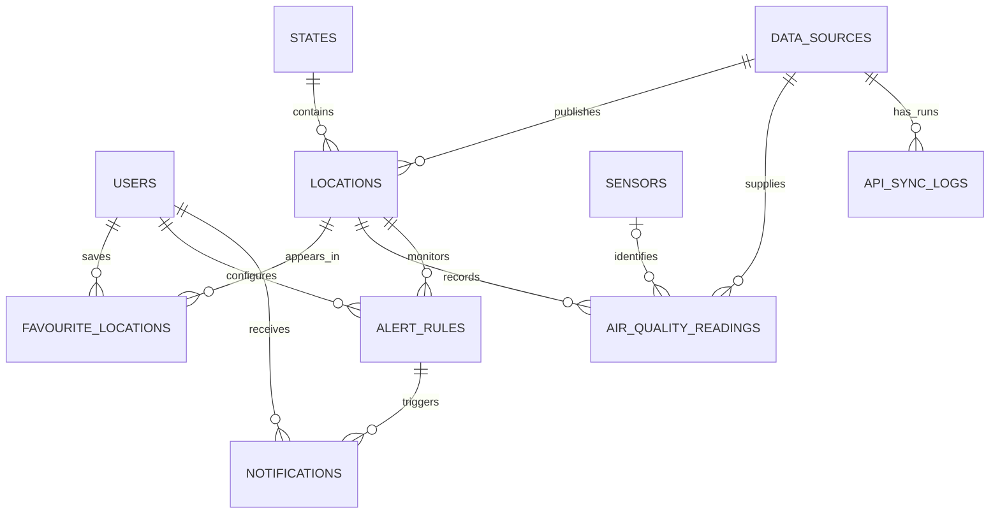

# HazeWatch technical architecture proposal

**Status:** Planning proposal; no application code has been implemented.  
**Date researched:** 3 November 2026 (Asia/Kuala_Lumpur)

## 1. Scope and architecture

HazeWatch is a server-rendered Core PHP application. PHP handles routes, validation, authorization, business rules, and HTML/JSON responses. JavaScript is limited to progressive enhancement and Chart.js rendering. MySQL is the durable store. A CLI cron entry point imports provider data and evaluates alerts; web requests never trigger an unbounded provider poll.

Use Composer only for PSR-4 autoloading and modest development tooling if approved; no application framework is proposed. Keep a small front controller and explicit route definitions. The dependency direction is:

```text
HTTP / CLI -> middleware + controller/command -> service -> repository -> PDO -> MySQL
                                                service -> provider interface -> Haze Monitor client
```

Controllers translate requests and responses. Services own use cases and business rules. Repositories own SQL. The API client owns HTTP transport and provider errors. A normalizer maps documented external values into internal records while preserving provenance. PHP views escape output by default. Cron invokes the same services as the web app.

## 2. Proposed directory structure

```text
hazewatch/
├── app/
│   ├── Controllers/       # Web and JSON request handlers
│   ├── Middleware/        # Authentication, role, CSRF
│   ├── Models/            # Small domain/data objects, not SQL gateways
│   ├── Repositories/      # PDO queries and persistence
│   ├── Services/          # Use cases, validation, normalization, alerts
│   ├── Providers/         # ProviderInterface, HazeMonitor client/adapter
│   ├── Http/              # Request, Response, Router
│   └── Support/           # Config, clock, logger, escaping helpers
├── bootstrap/             # Environment/config loading and container wiring
├── config/                # Application and database config (no secrets)
├── database/
│   ├── migrations/
│   └── seeders/
├── docs/                  # Architecture, decisions, data mapping
├── public/                # Document root; index.php, assets, .htaccess
├── resources/views/       # Layouts, pages, components
├── routes/                # web.php and api.php
├── storage/               # Writable logs/cache; deny web access
├── bin/                   # CLI commands
├── tests/                 # Unit and integration tests
├── .env.example
├── .gitignore
├── composer.json
└── README.md
```

Only `public/` is exposed by the web server. `.env`, `storage/`, migrations, and source files remain outside the document root.

## 3. Database ERD and relationships



`SENSORS` is optional: the current provider station response does not expose a sensor identifier. Keep it only if future provider payloads supply stable sensor identity; otherwise station identity lives on `locations` and nullable `sensor_id` can be deferred.

## 4. Schema proposal

Use InnoDB, `utf8mb4`, UTC `DATETIME(3)` timestamps, foreign keys, and explicit indexes. IDs may be `BIGINT UNSIGNED AUTO_INCREMENT`; provider IDs are retained separately as strings.

| Table | Important columns and constraints |
|---|---|
| `users` | id, name, email (unique), password_hash, role (`user`/`admin`), status, created_at, updated_at |
| `states` | id, name, code (unique; nullable if provider has no stable state code) |
| `data_sources` | id, name, base_url, source_type, enabled, created_at; unique name |
| `locations` | id, state_id nullable, data_source_id, external_id, name, full_name, region nullable, latitude/longitude nullable, active, created_at, updated_at; unique `(data_source_id, external_id)` |
| `sensors` (defer unless identity exists) | id, location_id, external_id, name, metadata JSON nullable; unique `(location_id, external_id)` |
| `air_quality_readings` | id, location_id, data_source_id, sensor_id nullable, metric, value DECIMAL(12,4) nullable only if modelling explicit unavailable records is chosen, unit nullable, source_metric, source_unit nullable, category nullable, observed_at UTC, fetched_at UTC, external_dedupe_key; unique `(data_source_id, location_id, metric, observed_at, external_dedupe_key)` or a stable provider reading ID; indexes `(location_id, metric, observed_at)` and `(observed_at)` |
| `favourite_locations` | user_id, location_id, created_at; composite primary key `(user_id, location_id)` |
| `alert_rules` | id, user_id, location_id, metric, operator, threshold DECIMAL(12,4), enabled, last_state nullable, cooldown_until nullable, created_at, updated_at; index `(enabled, location_id)` |
| `notifications` | id, user_id, alert_rule_id nullable, location_id nullable, type, title, body, dedupe_key, created_at, read_at nullable; unique `(user_id, dedupe_key)` |
| `api_sync_logs` | id, data_source_id, started_at, finished_at nullable, status, http_status nullable, request_id nullable, records_received, records_saved, error_code nullable, safe_error_summary nullable; index `(data_source_id, started_at)` |

Do not persist fake or zero readings for missing data. Represent an absent measurement as absent. When the source gives an explicit null `api` or `pm10Api`, retain an availability outcome in sync/quality metadata, not as zero. If future auditing requires storing null observations, add an explicit availability status and relax the value constraint intentionally.

### Measurement and duplicate decisions

Store each metric as a separate row, with the original source label/value/unit and normalized metric/unit kept distinct. This supports additional pollutants without adding columns. The current API does not document raw units or a stable reading ID; a candidate idempotency key is source + station ID + metric + exact provider observation timestamp, pending confirmation of timestamp granularity and update behavior. A unique index prevents replay duplicates; if providers revise values at the same timestamp, use an upsert policy and preserve a revision/audit trail decision.

## 5. External API integration design

### Verified provider facts

The developer page documents a public, read-only API; no API key; JSON requests should send `Accept: application/json`; there is no contractual rate limit or uptime guarantee. Clients must obey each response's `Cache-Control`, avoid polling more frequently than its lifetime, cache responses, and use `Retry-After` for temporary failures. Error JSON contains stable `code`, `message`, `resolution`, and `requestId`. Current Malaysia data is from Department of Environment (DOE) stations, each with its own observation time.

The OpenAPI schema documents `/api/air-quality` and `/api/air-quality/history`. A current station object has `id`, `name`, `fullName`, `state`, `region`, `latitude`, `longitude`, `api`, `pm10Api`, `category`, `pollutant`, `observedAt`, and `isFallback`. The snapshot has `source`, `sourceUrl`, `fetchedAt`, `observedAt`, `stationCount`, `reportingCount`, and `stations`. History readings expose `observedAt`, `api`, and `pollutant`; archive points expose `observedAt`, `api`, `low`, `high`, and `count`.

The live API was queried read-only on 3 Nov 2026 MYT. Its current response contained the documented snapshot keys and 68 stations, with `stationCount=68` and `reportingCount=68`. The first rows were `CA01R` (Kangar, Perlis) and `CA02K` (Langkawi, Kedah), each carrying coordinates, an `api` value, a category, `pollutant=PM2.5`, and an ISO observation time with `+08:00`. In this response `pm10Api` was null for all 68 stations. The actual station objects did not include `isFallback`, despite that field appearing as required in the published OpenAPI schema. The normalizer therefore does not depend on `isFallback`.

The sampled API values were index values such as `41` and `34`; the pollutant text is not a PM2.5 concentration and no PM2.5 concentration or unit field was present. The documented recent-history operation, called with no query parameters, returned all 68 station IDs with hourly readings shaped as `{observedAt, api, pollutant}`; one example returned 24 hourly points. The `station=CA01R&range=month` response instead returned aggregate points shaped `{observedAt, api, low, high, count}`. These are API/IPU histories, not pollutant concentration series.

Current, recent-history, and month-history responses returned `Cache-Control: public, s-maxage=300, stale-while-revalidate=...`, so the PHP client caches them for five minutes and does not use stale-while-revalidate as permission to poll again. The developer page states there is no contractual rate limit or uptime guarantee. Sanitized live current, recent-history, and month-history responses are retained under `tests/fixtures/` for deterministic adapter checks. This station roster is a snapshot, not a permanent list; synchronization upserts provider station IDs and does not seed guessed city names.

### Known limitation: unit and semantics confirmation

The OpenAPI field names and types do **not** define units for `api` or `pm10Api`. The API field is presented by Haze Monitor as Malaysia's DOE API/IPU. In the sampled response, `pm10Api` was null across the station roster. The `pollutant` value indicates a driver but does not give a direct PM2.5 concentration. HazeWatch therefore stores `api` as `malaysia_api_ipu` with unit `index`, preserves the source metric/category, and omits missing values. PM2.5/PM10 concentration cards require a documented concentration feed/field or separately approved derivation with methodology and labels. Do not convert API/IPU values into pollutant measurements.

### Provider adapter flow

1. `HazeMonitorClient` performs GET with connect/overall timeouts, TLS verification, `Accept: application/json`, and a fixed allowlisted host.
2. Cache each JSON response using a key per endpoint/query. Honor `Cache-Control` directives and `Retry-After`; current and recent-history payloads currently publish `s-maxage=300`. Do not poll ahead of the published TTL. If a successful response omits a reusable freshness lifetime or declares `no-store`/`no-cache`, reject it for ingestion rather than inventing a refresh interval. On a transient failure, serve last-known-good data only with its original observation/fetch timestamps and stale label (stale serving is not part of the first M3 sync command).
3. Decode JSON and validate required structure/types. Reject malformed top-level data; treat nullable values as missing. Capture safe error code/request ID in sync logs; do not log secrets or full uncontrolled payloads.
4. `HazeMonitorNormalizer` maps station ID to provider location, maps `api` and `pm10Api` only to confirmed source metrics, retains exact source labels and category, and parses timestamps as UTC.
5. `DataSyncService` upserts roster, persists available readings transactionally, deduplicates, then marks run success/partial/failure. A failed fetch never overwrites current valid data.
6. Schedule CLI collection no more frequently than the effective cache lifetime; initial schedule remains configurable and is finalized after observing headers. Use bounded retries with backoff and honor `Retry-After`.

`AirQualityProviderInterface` should expose small operations such as `fetchCurrent()` and `fetchHistory(stationId, range)`. The client owns transport; adapter owns schema mapping; sync service owns persistence workflow. A second provider can implement the interface later. Do not merge unlike indices or units into one metric.

### Mapping table

| Haze Monitor value | Internal destination | Rule |
|---|---|---|
| `source`, `sourceUrl` | `data_sources.name`, `base_url` | DOE is measurement origin; Haze Monitor is transport/provider. Preserve both in source metadata or provider fields so attribution is clear. |
| station `id` | `locations.external_id` | Unique within provider; never substitute city name. |
| `name`, `fullName`, `state`, `region`, coordinates | `locations` and `states` | Preserve provider names; nullable coordinates/state mapping handled without guessing. |
| `api` | `air_quality_readings.value` with metric `malaysia_api_ipu` | Official DOE index; unit/index scale label stored as `index` only after contract is confirmed; retain category. |
| `pm10Api` | not persisted in M3 | It was null in the sampled roster; never map it to `pm10` concentration without provider semantics and unit confirmation. |
| `pollutant` | `source_metric`/source metadata | Preserve exact source string; validate known values when mapping; no assumptions. |
| `category` | `category` | Preserve provider category; no HazeWatch recalculation. |
| station `observedAt` | `observed_at` | Per station, parse offset and convert UTC; null means unavailable. |
| snapshot `fetchedAt` | sync log end/fetched timestamp | Retrieval time, distinct from observation time. |
| error `code`, `requestId` | `api_sync_logs.error_code`, `request_id` | Keep safe diagnostics and run status. |
| recent-history `stations[].readings[]` | `air_quality_readings` | Hourly API/IPU points normalize to the same metric with per-point UTC timestamps. |
| history `low`, `high`, `count` | archive payload/aggregate model (future) | Not individual readings; do not insert as raw hourly rows. |

## 6. Milestones and acceptance gates

| Milestone | Deliverable and exit criteria |
|---|---|
| M1: project foundation | Composer/autoload/bootstrap, environment config, front controller/router, error handling/logging, README; clean install works and secrets stay out of Git. |
| M2: schema and persistence | MySQL migrations/seeders, PDO connection, constraints and commands implemented; database application remains to be confirmed against a running MySQL 8 instance. Base states and provider source are seeded; the confirmed station roster is upserted by M3 sync. |
| M3: provider ingestion | Captured payload/header fixture, validated client/normalizer/sync command; cache honored, idempotent repeat sync, failure preserves last good record. |
| M4: public dashboard | Server-rendered current station listing with truthful unavailable/stale states and attribution; search by station/state. |
| M5: station details/history | Detail pages and Chart.js history; gaps preserved, range supported by provider, timestamps/units labeled. |
| M6: authentication/favourites | Registration/login/logout, secure sessions, favourites and authorization. |
| M7: alerts/notifications | User rules, edge/cooldown/dedupe behavior, in-app notification history. |
| M8: scheduled collection/quality | Cron deployment guide, bounded retries, stale/missing quality status and sync dashboard data. |
| M9: admin tools | Restricted station and sync views/actions, CSRF and audit logging. |
| M10: portfolio hardening | Full test pass, accessibility/responsive review, deployment/backup instructions, demo dataset clearly identified. |

Do one milestone at a time and seek approval before starting the next, as the PRD requests.

## 7. Testing strategy

- Unit tests for response validation, normalization, UTC parsing, metric mapping, missing/stale handling, alert transitions, and dedupe key generation.
- Provider contract tests using sanitized fixtures from actual successful, partial, and error responses. Tests must not make live network requests.
- Repository integration tests against a disposable MySQL 8 database for migrations, FK restrictions, unique idempotency, transactions, retrieval ordering, and notification constraints.
- HTTP/controller tests for validation, authorization, CSRF, response codes, and escaped output.
- CLI sync tests with fake provider and clock, including cache lifetime, retry-after, timeout, and last-known-good behavior.
- Security-focused tests for SQL injection, XSS, CSRF, session rotation, role enforcement, and rate limiting.
- Manual acceptance checks for narrow/mobile layouts, missing station measurements, stale timestamps, chart gaps, and accessible status text.

Use PHPUnit only if dependency approval is given; otherwise begin with a small project test harness. Keep tests deterministic using injected provider/clock fakes. User-directed testing can be run milestone by milestone.

## 8. Security checklist

- [ ] Web root is only `public/`; deny access to `.env`, `storage/`, source, and migration files.
- [ ] Store secrets in environment, commit `.env.example` only, and use least-privilege MySQL credentials.
- [ ] Use PDO prepared statements and disable emulated prepares where supported.
- [ ] Validate and allowlist inputs; escape all rendered text with `htmlspecialchars`.
- [ ] CSRF tokens on state-changing form/API requests; same-site cookie policy.
- [ ] Session cookies `HttpOnly`, `Secure` in HTTPS, `SameSite=Lax` or stricter; strict mode; rotate ID after login/privilege change; inactivity expiry.
- [ ] `password_hash()`/`password_verify()` and generic login failure messages; rate-limit login/reset paths.
- [ ] Central authorization checks for every admin and user-owned resource; deny by default.
- [ ] No unsafe URL/host input to cURL; fixed HTTPS provider host, TLS verification on, bounded timeouts and response size.
- [ ] Respect cache/retry headers; bounded retry policy; no API key exposure (none currently required).
- [ ] Log request IDs and safe summaries; redact credentials, session IDs, and unnecessary personal data; avoid logging complete provider payloads by default.
- [ ] Use transactions for sync and user-visible state changes; validate before writes.
- [ ] Add security headers (CSP appropriate to Chart.js delivery, frame/content-type/referrer protections) and HTTPS deployment.
- [ ] Keep dependencies minimal and pinned; review updates and production error display settings.
- [ ] Back up database and test restore before production deployment; limit admin account creation and audit privileged actions.

## 9. Decisions and uncertainties requiring confirmation

1. **Display scope:** the confirmed Malaysia endpoint supplies official API/IPU. The sampled `pm10Api` values were null and its semantics/units remain undocumented. Is the first public release allowed to show official IPU only until a reliable source explicitly exposes PM2.5 and PM10 concentrations?
2. **Source of truth:** use Haze Monitor's DOE-backed API for the first adapter, with official DOE as the measurement origin. Should OpenAQ or data.gov.my be evaluated only after the first provider adapter, or is a second source required in MVP?
3. **Historical charts:** the documented API history provides API/IPU observations and month/year aggregates; it does not promise 24-hour/7-day/30-day pollutant-concentration series. Are charts for official API/IPU acceptable where available, with the PRD's pollutant history deferred until concentration data is established?
4. **Data retention:** proposed schema stores provider observations for trend/alerts. Confirm acceptable retention and whether complete raw response payloads should be discarded after normalization (recommended) or retained in a bounded audit store.
5. **Dependencies:** approve Composer autoloading and PHPUnit for maintainability/testing, while keeping the runtime Core PHP without a framework?
6. **Location model:** should HazeWatch initially list all currently reporting DOE stations, rather than the ten city names in the PRD (which may not match station locations)?
7. **Alert metric:** should first alert rules use official API/IPU thresholds only, until pollutant concentration metrics and their units are verified?

Items 1, 3, 6, and 7 determine truthful MVP behavior. Item 5 is a lightweight implementation choice. The sampled cache lifetime is five minutes; the sync command uses response headers dynamically and does not define a separate polling schedule.

## References

- [Haze Monitor developer documentation](https://hazemonitor.com/developers)
- [Haze Monitor OpenAPI 3.1 specification](https://hazemonitor.com/openapi.json)
- [Current Malaysia endpoint](https://hazemonitor.com/api/air-quality)
- [Malaysia history endpoint](https://hazemonitor.com/api/air-quality/history)
- [Live Haze Monitor homepage and current station snapshot](https://hazemonitor.com/)

